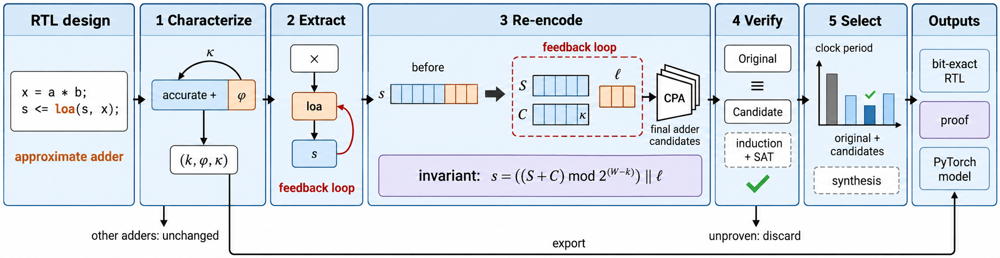

# BEAR

BEAR re-encodes accumulators built from approximate adders while preserving their bit-exact outputs. It characterizes the adder, extracts feedback and control paths, generates candidates, verifies equivalence, and selects the fastest proven implementation or the smallest one that meets a target clock.



## Requirements

Use Python 3.10 or later with NumPy, on Linux or a Linux environment on Windows. The RTL flow needs Yosys with ABC, SymbiYosys with z3, OpenSTA, and Verilator with a C++ build toolchain for the verification interface's simulation cross-check. Icarus Verilog is needed only for the optional RTL integration checks.

Put the tools on `PATH`. Executables can also be set individually through `BEAR_YOSYS`, `BEAR_YOSYS_ABC`, `BEAR_SBY`, `BEAR_Z3`, `BEAR_STA`, and `BEAR_VERILATOR`. SymbiYosys must find its solvers on `PATH`. Supply a Liberty library and ABC constraints with `--liberty` and `--constraints`, or with `BEAR_LIBERTY` and `BEAR_CONSTRAINTS`. The supplied timing adapter retains its original Nangate45 cell, wire-load and output-load assumptions; use a compatible library. The ABC constraint file uses `set_driving_cell INV_X1` and `set_load 6.80092` for that library.

PyTorch and CUDA are optional export dependencies; neither is required for the RTL flow. GPU export execution additionally needs Triton; CPU export works without CUDA or Triton. Install BEAR with:

```sh
python -m pip install .
# Optional PyTorch/CUDA export dependencies:
python -m pip install '.[export]'
```

## Steps

1. **Characterize** (`bear characterize`) finds the smallest supported low-region width and records the low output function and carry. Small adders use exhaustive evaluation; wider adders use SAT queries.
2. **Extract** (`bear extract`) follows characterized adders to feedback registers and records their operands, resets, enables and control paths.
3. **Re-encode** (`bear reencode`) emits carry-save RTL with the original low-region function, final-adder alternatives and merged accurate arithmetic. `--block-size 2|4` retains registered carries between blocks for direct-feedback accumulators; `--pipeline-stages 2|3` pipelines the final addition.
4. **Verify** (`bear verify`) proves equivalence using state refinement and checks finite simulation separately. `--latency d` compares candidate outputs with reference outputs from d clocks earlier; generated pipeline metadata supplies this alignment automatically when passed with `--refinement`.
5. **Select** (`bear select`) chooses the smallest proven point under each requested clock budget by default. `--objective fastest` chooses the shortest measured cycle (`budget_delay_ps`) among proven candidates and the original design, breaking equal-cycle ties by smaller area; only full-prefix proofs admit replacements.

**Export** (`bear export CERTIFICATE.json accumulator.py`) creates a PyTorch accumulator and its certificate/LUT assets. The optional runtime provides fixed-order accumulation, CUDA kernels, and a quantized `Conv2d`/`Linear` wrapper through `bear.export.cert_runtime.CertificateQuantizedLayer`; generated modules import the installed BEAR package.

## Example

`examples/loa_accumulator.v` is an eight-bit LOA accumulator with three approximate LSBs (`W = 8`, `k = 3`). From this directory, one command runs the five steps for this design using your compatible timing library and ABC constraints:

```sh
bear run examples/loa_accumulator.v --top loa_accumulator --adders examples/adders.json --out output --liberty "$BEAR_LIBERTY" --constraints "$BEAR_CONSTRAINTS" --D 100 --budgets 2000
```

The output includes candidate RTL, proof records, timing/area points, `rewritten.v`, and `REPORT.md`. Add `--block-size 2` or `--pipeline-stages 3` to include that candidate in `bear run`; add `--objective fastest` to change the selection objective. `bear --help` lists the individual steps.

Pipeline delay is measured in extra clocks: candidate(t) = original(t-d), with reset filling delayed outputs with zero. The segmented generator uses segment count L, so d = L - 1 (three segments give d = 2); delays advance on every clock, including cycles with the accumulator enable low. Alignment requires a recognized clock and reset; `--readout-ports` can restrict alignment to named outputs, while other outputs remain same-cycle. Pass the candidate's `REWRITE.json` with `bear verify --refinement` to use its state relation and delay, or supply `--latency` explicitly.

The standalone `bear.reencode.block_accumulator_rtl(top, b, k, width, input_width)` emitter supports exact addition (`k=0`) and LOA low regions (`k>0`), with asynchronous active-low reset and zero extension of the input. The extraction-based block option uses this emitter, preserves the characterized low function and update/hold enable, and requires a positive-edge clock with asynchronous active-low zero reset; shifted or multiple-state feedback, other control paths and explicit initial states are rejected.

## Tests

```sh
python -m unittest discover -s tests -v
BEAR_INTEGRATION=1 python -m unittest discover -s tests -v
```

The second command enables optional installed-tool checks. Use `BEAR_WORK_DIR` and `TMPDIR` to choose where test and intermediate files are written.

## License

MIT. Copyright (c) 2026 Anonymous Authors. External tools and optional dependencies retain their own licenses.
